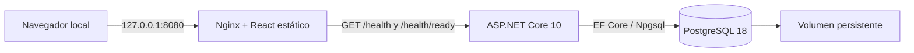

# Arquitectura real

Un monolito modular pragmático. `Features/Health` consulta estado; `Features/Configuration` modela configuración global, nunca información privada. `Infrastructure` contiene contexto, inicialización y opciones. No hay identidad falsa ni tablas de finanzas.

`GET /health` devuelve `{ "status": "ok", "service": "AlineaApp" }` si el proceso atiende. `GET /health/ready` devuelve 200 `{ "status": "ready" }` si no hay migraciones pendientes y existen las dos claves válidas; en caso contrario 503 `{ "status": "unavailable" }`. Sin detalles internos ni valores de configuración. Fallos inesperados: ProblemDetails genérico y traceId; logs JSON con tipo de excepción, sin mensaje sensible. El logging EF/Npgsql y del handler estándar se suprime para evitar fugas.

La UI consume ambos endpoints secuencialmente, valida el contrato, cancela al desmontar y limita cada solicitud a 8 segundos. Un fallo de PostgreSQL no se presenta como fallo del proceso API. Reintento explícito; no polling ni datos de demostración.

Compose publica solo Nginx en loopback. Red web bridge privada para Nginx/API, red datos con `internal: true` para API/PostgreSQL. Docker Desktop no materializa puertos publicados cuando el frontend solo pertenece a una red `internal`; por eso web usa bridge normal sin publicar API. El override local permite desarrollar con Vite/API nativos: API `127.0.0.1:5080`, BD `127.0.0.1:5432`. CORS cerrado salvo lista exacta opcional. Nginx añade CSP y headers; API y Nginx ejecutan sin root.

Futuro multiusuario: Identity y cookies HttpOnly/Secure, SameSite y CSRF según flujo. Toda entidad privada tendrá propietario; servidor deriva identidad de sesión, nunca confía en userId enviado por cliente. Tests cruzados entre usuarios serán obligatorios al introducir datos privados. No se construye todavía un modelo de organizaciones.

Cloudflare Tunnel futuro es transporte, no autenticación. Antes de exposición pública: autorización, HTTPS, proxy confiable acotado, rate limits OTP, gestión de secretos, permisos mínimos BD, backups restaurados y revisión de dependencias. No se publica en Fase 00.
