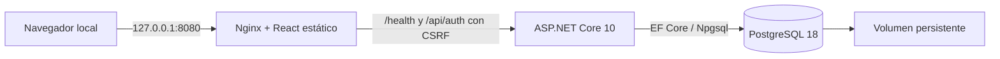

# Arquitectura real

Un monolito modular pragmático. `Features/Health` consulta estado; `Features/Configuration` modela configuración global, nunca información privada. `Infrastructure` contiene contexto, inicialización y opciones. No hay identidad falsa ni tablas de finanzas.

`GET /health` devuelve `{ "status": "ok", "service": "AlineaApp" }` si el proceso atiende. `GET /health/ready` devuelve 200 `{ "status": "ready" }` si no hay migraciones pendientes y existen las dos claves válidas; en caso contrario 503 `{ "status": "unavailable" }`. Sin detalles internos ni valores de configuración. Fallos inesperados: ProblemDetails genérico y traceId; logs JSON con tipo de excepción, sin mensaje sensible. El logging EF/Npgsql y del handler estándar se suprime para evitar fugas.

La vista técnica conservada en `/prototype` consume ambos endpoints secuencialmente, valida el contrato, cancela al desmontar y limita cada solicitud a 8 segundos. El acceso funcional predeterminado consume `/api/auth`; consulta sesión real y maneja indisponibilidad sin simular autenticación. Un fallo de PostgreSQL no se presenta como fallo del proceso API.

Compose publica solo Nginx en loopback. Red web bridge privada para Nginx/API, red datos con `internal: true` para API/PostgreSQL. Docker Desktop no materializa puertos publicados cuando el frontend solo pertenece a una red `internal`; por eso web usa bridge normal sin publicar API. El override local permite desarrollar con Vite/API nativos: API `127.0.0.1:5080`, BD `127.0.0.1:5432`. CORS cerrado salvo lista exacta opcional. Nginx añade CSP y headers; API y Nginx ejecutan sin root.

Fase 01 agrega `Features/Auth`: Identity/EF, OTP HMAC, sesiones persistidas con cookies HttpOnly/Secure/SameSite Strict y CSRF. El servidor deriva identidad de sesión y filtra perfiles por propietario. La lista de permitidos controla registro y sus revocaciones bloquean cuentas y sesiones existentes, según política aprobada. [ADR y límites](DECISIONS/0002-autenticacion-otp.md), [operación de autenticación](FASE-01-AUTENTICACION.md).

Fase 02B agrega `Features/Finance`, servido por `/api/finance`: bancos, cuentas y categorías propios de cada identidad. Escrituras con autorización, CSRF y transacción serializada por usuario; índices únicos y FK compuesta banco/propietario. No hay libro de movimientos ni organizaciones. El frontend autenticado reutiliza el cliente HTTP y controles existentes. [Decisiones financieras](DECISIONS/0003-catalogos-financieros.md), [resultado y operación](FASE-02B-RESULTADOS.md).

Cloudflare Tunnel futuro es transporte, no autenticación. Antes de exposición pública: autorización, HTTPS, proxy confiable acotado, rate limits OTP, gestión de secretos, permisos mínimos BD, backups restaurados y revisión de dependencias. No se publica en Fase 00.

Fase 02C añade transacciones y revisiones en el mismo módulo Finance. Transferencias representadas por una sola fila; saldos derivados con agregados SQL, sin balance mutable duplicado. Catálogos y libro comparten el advisory lock por usuario y transacciones PostgreSQL; lecturas financieras usan snapshot Repeatable Read para mantener coherencia entre detalle, revisiones, paginación y totales. Aperturas protegidas permanentemente tras el primer uso; versiones e idempotencia persistidas. [ADR 0004](DECISIONS/0004-transacciones.md), [entrega 02C](FASE-02C-RESULTADOS.md). Los párrafos de fases anteriores describen su alcance histórico.
